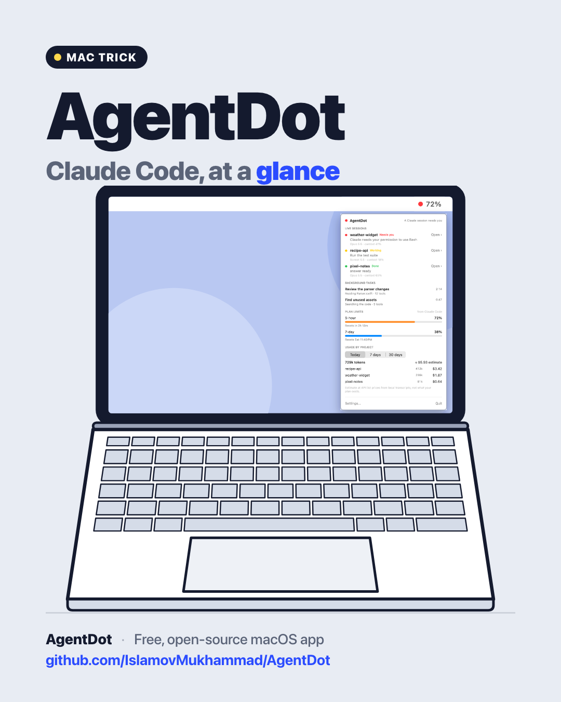
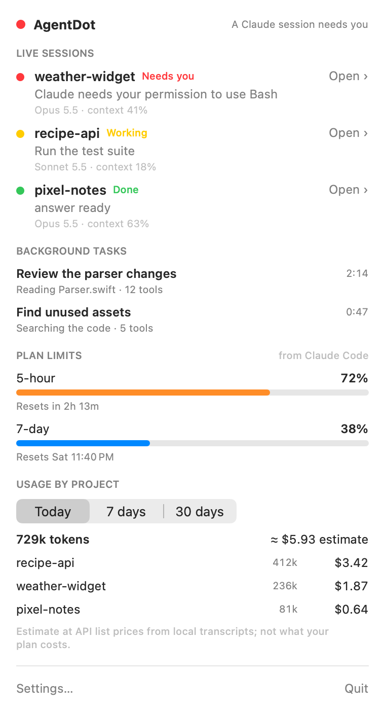
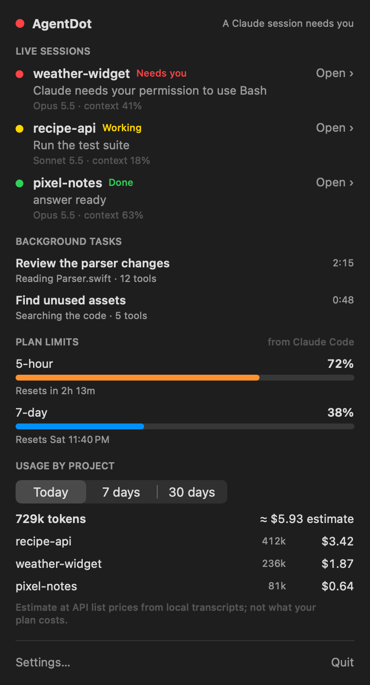
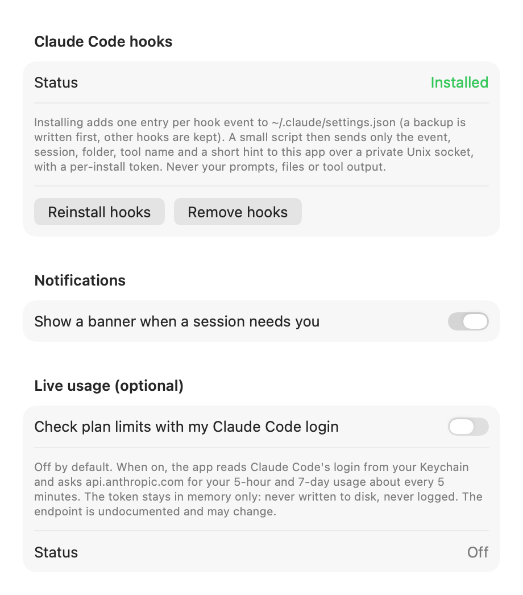

<p align="center">
  
</p>

# AgentDot

**A menu-bar dot for your Claude Code sessions, limits and token usage.**

A free, open-source macOS menu-bar app. One coloured dot tells you whether Claude Code is working, waiting for you
or idle; click it for everything else.

> Not affiliated with or endorsed by Anthropic. Claude and Claude Code are trademarks of Anthropic.

## Features

- **The dot.** Yellow = a session is working, red = a session needs you, grey = idle. Next to it, your 5-hour
  plan usage (`● 72%`). With no current limit data, only the dot shows.
- **Needs-you banner.** A macOS notification when a session starts waiting for a permission or an answer. Click it
  to bring that session forward. You can turn it off in Settings.
- **The panel** (click the dot) has four sections:
  1. **Live sessions**: each Claude Code session's folder, state (Working / Needs you / Done / Failed), current
     tool in plain words ("editing PanelView.swift", "Run the test suite"), model and context fill. **Open ›**
     brings forward the app that session runs in (a terminal or the Claude desktop app).
  2. **Background tasks**: running subagents with their name, running time, tool count and current action.
     Hidden when nothing runs.
  3. **Plan limits**: 5-hour and 7-day usage with reset times, labelled with where the numbers came from. Hidden
     when there's no data; a window past its reset shows "reset", never a stale number.
  4. **Usage by project**: tokens and an estimated cost per project for Today, 7 days and 30 days.
- **Settings**: install, reinstall or remove the Claude Code hooks; the banner on/off; optional Live usage.
- Menu bar only, no Dock icon. Native SwiftUI + AppKit, no third-party dependencies.

## Screenshots

<p align="center">
  
  
</p>

**The menu-bar item:** working, needs you, and idle

<p align="center">
  
  
</p>

**Settings**

<p align="center">
  
</p>

All screenshots are rendered by the app's demo mode with made-up projects and numbers.

## Where the data comes from

| Section | Source | Network |
|---|---|---|
| Live sessions | Claude Code hooks, sent to AgentDot over a private Unix socket. Model and context come from the session's transcript file. | none |
| Background tasks | Subagent files next to the session transcript, under `~/.claude/projects/` | none |
| Plan limits (default) | Claude Code's statusLine update (terminal Claude Code, Pro/Max plans) | none |
| Plan limits (Live usage, optional, off by default) | `api.anthropic.com`, using your Claude Code login from the Keychain, about every 5 minutes | only when you turn it on |
| Usage by project | Your local transcripts, `~/.claude/projects/**/*.jsonl` (including subagents), each message counted once | none |

The cost is an **estimate** at public API list prices. It is not what your plan costs you.

## Security

AgentDot reads parts of your Claude Code activity, so it is built to share as little as possible:

- **No network port.** Claude Code's hooks talk to AgentDot over a Unix socket,
  `~/Library/Application Support/AgentDot/agentdot.sock`, in a folder only you can open (0700; the socket is 0600).
  A web page or another user can't reach it.
- **A per-install token.** Installing the hooks creates a random 32-byte token (file 0600). Every request must carry
  it, compared in constant time. Requests with a browser `Origin` header, a type other than JSON, or more than 1 MB
  are dropped. With no hooks installed, everything is dropped.
- **Minimal hook payload.** The hook script sends only the event, session id, working folder, transcript path, tool
  name, a short hint (a description, a file *name*, a web *host*, a search query, a skill, or only the *program name*
  of a shell command) and notification text. It never sends your prompts, file contents, full commands or tool
  output. The statusLine script sends only the plan limits, session id and context fill.
- **Safe file reads.** Transcript and subagent paths must be regular files inside `~/.claude/projects`. Symlinks,
  pipes and devices are refused. All file reads happen off the main thread.
- **Your settings, backed up.** `~/.claude/settings.json` is only changed when you click **Install hooks**. The first
  change saves `~/.claude/settings.json.agentdot-backup`. Your other hooks and settings are kept, and an unreadable
  settings file is never overwritten. **Remove hooks** removes only AgentDot's entries.
- **Live usage is opt-in and off by default.** While it is off, the Keychain is never read. When it is on, the Claude
  Code login token is read from the Keychain and kept **in memory only**: never written to disk, never logged, and
  dropped when you turn the switch off or the server rejects it. Requests go only to
  `https://api.anthropic.com/api/oauth/usage`, without cache or cookies.

### What "Install hooks" adds

- `~/Library/Application Support/AgentDot/agentdot-hook.sh` and `agentdot-statusline.sh` (0700), plus `hook-token` (0600).
- One hook per event in `~/.claude/settings.json`: `SessionStart`, `UserPromptSubmit`, `PreToolUse`, `PostToolUse`,
  `SubagentStop`, `Notification`, `Stop`, `StopFailure`, `SessionEnd`.
- `statusLine`, **only if you don't have one**. AgentDot's script prints nothing, so the terminal status line stays
  empty. If you already have a statusLine, it's left alone, and plan limits then need Live usage.

## Requirements

- macOS 26 or later
- Claude Code (terminal or the Claude desktop app)
- Xcode 26 / Swift 6.2 toolchain to build

## Build from source

There is no prebuilt download. Build it yourself in a minute:

```bash
git clone https://github.com/IslamovMukhammad/AgentDot.git
cd AgentDot
./build.sh --install   # builds, copies to /Applications and launches
```

`./build.sh` alone puts the app in `build/AgentDot.app`. Run the tests with `swift test`.
The app icon is drawn in code: `swift Scripts/make_icon.swift` regenerates `Resources/AppIcon.iconset`.
Then open **Settings › Install hooks**.

## How it works

| Part | File |
|---|---|
| Hook and statusLine installer (scripts, token, settings.json edits) | `Sources/AgentDot/Claude/ClaudeHooks.swift` |
| Unix-socket receiver with the access rules | `Sources/AgentDot/Claude/EventServer.swift` |
| Session state machine and tool descriptions | `Sources/AgentDot/Claude/ClaudeStatus.swift` |
| Model and context from the transcript | `Sources/AgentDot/Claude/TranscriptReader.swift` |
| Background tasks | `Sources/AgentDot/Claude/SubagentScanner.swift` |
| "Open ›" | `Sources/AgentDot/Claude/SessionOpener.swift` |
| Plan limits and optional Live usage | `Sources/AgentDot/Usage/ClaudeLimits.swift`, `LiveUsage.swift` |
| Usage by project and cost estimate | `Sources/AgentDot/Usage/ProjectUsage.swift` |
| Menu-bar dot and panel | `Sources/AgentDot/UI/` |

## Known limitations

- Plan limits from Claude Code's statusLine only arrive with **terminal** Claude Code on Pro/Max plans, after its
  first answer. The Claude desktop app doesn't run the statusLine; use Live usage there.
- Live usage relies on an **undocumented** endpoint that may change. An expired login isn't refreshed by AgentDot;
  opening Claude Code does that.
- The cost is an **estimate** at API list prices, not a bill. Models without a known price count as $0, and the panel says so.
- "Open ›" brings forward the app, not a specific tab inside the Claude desktop app.
- The first usage scan of a large `~/.claude/projects` takes a few seconds in the background.
- Notifications need the built `.app` (not `swift run`).
- English UI only.

Bug reports and pull requests are welcome.

## Credits

Originally built as part of the author's personal desk companion app.

## License

[MIT](LICENSE) © 2026 Muhammad Islamov

## Follow

- GitHub: [@IslamovMukhammad](https://github.com/IslamovMukhammad)
- Telegram: [t.me/infinitwo](https://t.me/infinitwo)
